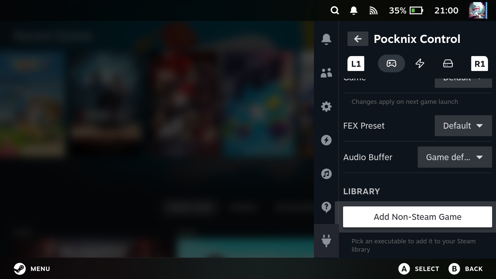

# Pocknix Control

**Pocknix Control** is pocknix-os's built-in Decky plugin: a control panel inside the Steam
session for tuning the handheld and managing the system without leaving the couch (or touching
a terminal).

Open the **Quick Access menu** in the Steam session, then pick **Pocknix Control** under the
plug icon. The plugin is split into four tabs - switch between them with **L1/R1** or by
tapping the icons:

| Tab | What it does |
|---|---|
| 🎮 Games | Fan curve, CPU scheduler and game tweaks, globally or per game |
| 📚 Library | Add non-Steam games, share your files over the network |
| 🕹️ Controller | Stick and trigger calibration, stick lights |
| 🔄 Updater | Check for and install system updates, roll back the last update |

Settings save automatically as you change them.

## Games

### Game tweaks

Tweaks can be set globally (the **Default** entry in the **Game** dropdown) or per game.
Every installed Steam game is listed, and so are non-Steam shortcuts (marked `· non-Steam`).
If you open the menu while a game is running, that game is preselected. To override the
defaults for one game, select it and flip **Use Per-Game Settings** on.

Two sections follow: **Performance** (applies live) and **Game Tweaks** (applies on the
**next game launch**, except where noted). A game's settings are also reachable from its
library page: **Manage → Pocknix Settings**.

**Performance**

- **Fan Curve**: **Quiet**, **Moderate**, or **Performance**. Applies live, no restart.
- **CPU Scheduler**: **Autopilot** (the `scx_lavd` default - adapts to load on the fly) or
  **Performance** (keeps the CPU aggressive at the cost of battery and heat).

Per game, either can stay on the global value.

**Game Tweaks**

- **Proton Version** (per game only): the compatibility tool Steam launches the game with,
  the same setting as the game's **Properties → Compatibility**. Proton-GE and Proton-CachyOS
  show up in this list once you install them from the **Pocknix Store** (Compatibility).
- **FEX Preset**: **Default**, **Fast**, or **Compatible**. Trades x86 translation accuracy
  for speed. Try **Fast** for more FPS; switch to **Compatible** if a game misbehaves
  (crashes, glitched physics, odd audio).
- **Audio Buffer**: **Game default**, **60**, **90**, or **120 ms**. Raising the buffer
  absorbs audio crackle in busy scenes (an FEX audio-mixer quirk) at the cost of a little
  extra audio latency. 120 ms clears crackle and is inaudible in most games. Keep it low (or
  on Game default) for timing-sensitive titles - rhythm games, fighting games, anything where
  you play to the beat or need tight audio cues.
- **Disable Touchscreen**: switches the touchscreen off while the game runs, so a thumb
  resting on the screen edge cannot fire stray taps. It comes back as soon as the game exits.
  While it is off, touch is off everywhere, the Steam overlay and on-screen keyboard included;
  use the controls there. Unlike the other tweaks this one takes effect immediately, even
  mid-game, and it works for every game Steam launches, native and emulators included.
- **Mesa Version** (per game only): run the game on a different Turnip (GPU driver) build
  than the system default, when more than one is installed.
- **Disable Xalia**: on by default. Xalia is Proton's controller-navigation helper and costs
  CPU in every game; turn this off only for a game that needs it.
- **Environment Variables**: extra variables for the game's launch, the same as a Steam
  launch option.

### Sharing a game's config

With per-game settings on, the **Config** section exports the game's settings to a
`<name>.pocknix.json` file, and imports one, so a tuned setup can be passed to other Pocknix
users. Importing overwrites that game's settings.

## Library

### Adding non-Steam games

Steam's own **Add a Non-Steam Game** dialog does not work on pocknix-os, so add them here:

1. In the **Library** tab, press **Add Non-Steam Game**.
2. A file picker opens in your home directory. Navigate to the executable you want
   (a Linux binary, script, or Windows `.exe`) and select it.
3. Give it a name, and choose whether to **Launch with Proton**. This switches on
   automatically for `.exe` files - Windows programs need it, native Linux ones do not.
4. Press **Add to Library**. The game appears in your Steam library right away, and also
   shows up in the tweaks dropdown above so you can give it its own FEX/audio settings.

### File sharing

**Share my home folder** turns the device into a network share, so you can drag ROMs, BIOS files
and emulator firmware onto it from another computer. Turn it on the first time in **Pocknix
Tools** → **Network**, which asks for deck's password: you sign in to the share as deck with it.

> Anyone on the same network who knows deck's password can read and write your home folder, so
> turn it off when you are done. See
> [copying files over the network](emulation-setup.md#copying-files-over-the-network) for how to
> connect.

## Controller

- **Calibration**: **Calibrate Controller**, then **Start**, walks each stick and trigger to its edge and back, then
  shows live readings to check (a full push reads 100 at the edge, 0 at rest). **Save** keeps
  it across reboots, **Discard** drops it, **Reset to Defaults** returns to the driver's
  values. The controller is paused for Steam while it runs, so **Cancel** works by touch.
  Boards whose gamepad driver cannot be calibrated say so.
- **Stick Lights** (boards with stick LEDs): **Enable**, **Link Left & Right** to give both
  sticks one colour, **Side Lights** to match the side lighting to the sticks, then colour and
  brightness per stick.

## Updater

System updates, without leaving game mode:

1. **Check for Updates** lists everything pending (kernel included - updates ship through
   the pocknix pacman repo, so no reflashing).
2. **Install Updates** downloads and installs the lot. Keep the device powered; a running
   game may stutter while it installs.
3. Restart when it finishes to apply everything (**Restart Now** appears right there).

The update keeps running even if you close the Quick Access menu - reopen the tab to check
on progress. If you prefer, the same update is just `sudo pacman -Syu` in a terminal, or
**Pocknix Tools** → **System** → **Update now**.

### Rolling back an update

Every update takes a snapshot first. If one breaks something, press **Roll Back Last Update**,
confirm, and **Reboot Now**: the system comes back as it was before the update, and your games,
saves and settings are untouched. To go back further, or when game mode itself is broken, see
[snapshots and rollback](snapshots.md).
